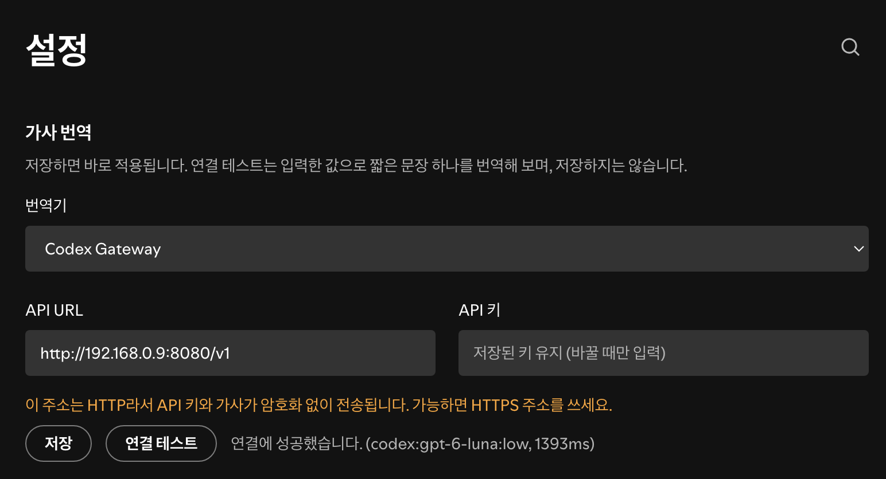
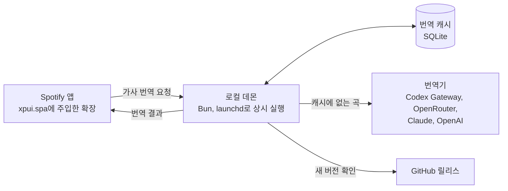

<div align="center">

# Spotify Lyrics Translator

Spotify 데스크톱 앱의 가사 화면에서 원문 줄마다 LLM 번역을 한 줄씩 붙여 보여 줍니다.<br>
Spicetify 없이 동작하고, Spotify가 업데이트되어 패치가 풀리면 알아서 다시 적용합니다.

[설치](#설치) · [사용법](#사용법) · [번역기 설정](#번역기-설정) · [자동 업데이트](#자동-업데이트) · [문제 해결](#문제-해결) · [제거](#제거) · [최신 릴리스](../../releases/latest)

<br>


</div>

## 특징

- **원문 아래 번역 한 줄**: Spotify 가사와 같은 색과 서체를 쓰고, 크기만 작고 조금 흐리게 보입니다. 지금 부르는 줄 강조도 원문과 함께 바뀝니다.
- **섞인 언어도 끝까지**: 일본어, 중국어, 영어, 한국어가 섞인 가사도 줄마다 번역합니다. 한 줄 안에 여러 언어가 섞여 있으면 그 줄 전체를 한국어로 옮깁니다.
- **번역이 필요 없는 줄은 건너뜀**: 전부 한국어인 줄, 빈 줄, `♪` 같은 기호 줄, "oh", "la la" 같은 추임새는 번역하지 않습니다.
- **남은 줄은 한 번 더**: 번역을 받은 뒤 다른 언어가 그대로 남은 줄이 있으면, 그 줄만 곡 전체를 참고해 한 번 더 번역합니다.
- **곡 단위 캐시**: 한 번 번역한 곡은 캐시에서 바로 나옵니다.
- **설정 화면에서 변경**: Spotify 설정 화면에서 번역기, API URL, API 키를 바꾸고 연결을 시험합니다.
- **번역기 선택**: Codex Gateway, OpenRouter, Claude, OpenAI 중에서 고릅니다.

## 설치

### 에이전트로 설치

Claude Code, Codex CLI처럼 터미널 명령을 실행할 수 있는 코딩 에이전트에 아래 프롬프트를 그대로 붙여 넣습니다. 요구 사항 확인부터 데몬 등록과 패치 확인까지 에이전트가 진행합니다. API 키는 에이전트에게 주지 않고, 마지막에 Spotify 설정 화면에서 직접 넣습니다.

```text
이 Mac에 Spotify Lyrics Translator를 설치해 주세요.
Spotify 데스크톱 가사 화면에 LLM 번역을 줄마다 붙여 주는 도구입니다.

꼭 지킬 것
- API 키를 대화로 받지 말고, .env 내용을 읽거나 출력하지 마세요.
- Spotify 종료와 시스템 설정 변경은 사용자에게 맡기세요.

순서
1. 다음이 모두 있는지 확인하고, 없는 것이 있으면 멈추고 알려 주세요.
   macOS, /Applications/Spotify.app, git, zip, unzip
2. 다음 파일이 있으면 이미 설치된 상태입니다. 멈추고 어떻게 할지 물어보세요.
   ~/Library/LaunchAgents/local.spotify-lyrics-translator.plist
3. bun이 없으면 사용자에게 물어본 뒤 https://bun.sh 의 공식 방법으로 설치하세요.
4. https://api.github.com/repositories/1389677500 응답의 clone_url을
   ~/spotify-lyrics-translator 로 clone하세요.
   폴더가 이미 있으면 멈추고 물어보세요.
5. 그 폴더에서 실행하세요.
   cp .env.example .env
   chmod 600 .env
   bun run install-agent
6. 최대 1분 동안 bun run status로 patchedHash가 null이 아닌지 확인하세요.
   계속 null이면 아래 로그의 끝부분을 읽으세요.
   bun run logs는 끝나지 않으니 쓰지 마세요.
   "$HOME/Library/Application Support/spotify-lyrics-translator/daemon.log"
   patch check failed가 보이면 시스템 설정의 개인정보 보호 및 보안에서
   앱 관리 권한을 터미널과 Bun에 켜 달라고 안내하세요.
   켠 뒤에 bun run restart-agent를 실행하고 다시 확인하세요.
7. 끝나면 사용자에게 다음을 안내하세요.
   - Spotify를 완전히 종료했다가 다시 켭니다.
   - 설정 화면 맨 위 "가사 번역"에 번역기, API URL, API 키를 넣습니다.
   - 연결 테스트로 확인한 뒤 저장합니다.
   - 데몬이 설치 폴더를 계속 쓰므로 폴더를 옮기거나 지우면 안 됩니다.
```

### 요구 사항

| 항목 | 확인한 버전 |
|---|---|
| macOS | 27.2 |
| Spotify 데스크톱 | 1.3.6.1921 |
| Bun | 1.3.5 |
| `zip`, `unzip` | macOS 기본 포함 |

패처가 `/Applications/Spotify.app` 안의 파일을 고치기 때문에, 명령을 실행하는 터미널 앱에 macOS의 "앱 관리" 권한이 있어야 합니다. 시스템 설정의 개인정보 보호 및 보안에서 켤 수 있습니다.

### 직접 설치

1. 저장소를 `git clone`으로 받고 그 폴더로 들어갑니다. 자동 업데이트는 clone한 폴더에서만 동작합니다.

2. 설정 파일을 만듭니다.

   ```bash
   cp .env.example .env
   chmod 600 .env
   ```

3. `.env`에 쓸 번역기와 키를 넣습니다. 자세한 값은 [번역기 설정](#번역기-설정)을 봅니다. 번역기, API URL, API 키는 설치가 끝난 뒤 Spotify 설정 화면에서 넣어도 됩니다.

4. 데몬을 launchd에 등록합니다. 등록하면 바로 실행되고, 로그인할 때마다 자동으로 켜집니다. 처음 실행될 때 원본 `xpui.spa`를 백업하고 확장을 주입합니다.

   ```bash
   bun run install-agent
   ```

5. Spotify를 완전히 종료했다가 다시 켭니다. 주입한 스크립트는 Spotify가 시작될 때 읽힙니다.

6. 가사가 있는 곡을 틀고 가사 화면(오른쪽 패널 또는 전체 가사 화면)을 엽니다. 처음 보는 곡은 10초에서 25초쯤 뒤에 번역이 붙습니다.

## 사용법

### 설정 화면

Spotify 설정 화면 맨 위의 "가사 번역"에서 바꿉니다.



| 항목 | 설명 |
|---|---|
| 번역기 | 고르면 그 번역기에 저장된 주소와 키 상태로 바뀝니다 |
| API URL | 번역기 주소입니다. 다른 서버로 주소를 바꿀 때는 키도 함께 입력해야 합니다 |
| API 키 | 저장한 뒤에는 다시 표시되지 않습니다. 칸을 비워 두면 그 번역기에 저장된 키를 그대로 씁니다 |
| 저장 | `.env`에 기록하고 데몬을 다시 시작하지 않아도 바로 적용합니다. 지금 곡도 새 번역기로 다시 번역합니다 |
| 연결 테스트 | 입력한 값으로 짧은 영어 문장 하나를 실제로 번역해 봅니다. 저장하지 않으며, 번역기 사용량이 조금 나갑니다. 키가 틀렸는지, 주소나 모델을 찾지 못했는지, 서버에 닿지 않는지를 알려 줍니다 |

### 가사 화면

- **번역 켜고 끄기**: Spotify 창에서 `Alt+T`(`Option+T`)를 누릅니다. 입력칸에 글자를 넣는 중에는 동작하지 않습니다. 설정은 기억됩니다.
- **번역 시점**: 가사 화면이 열려 있을 때만 지금 곡을 번역합니다. 가사 화면을 닫아 두면 요청하지 않습니다.
- **곡 넘기기**: 빠르게 여러 곡을 넘기면 멈춘 곡 하나만 번역합니다. 넘어간 곡의 진행 중 요청은 번역기 호출까지 취소됩니다.
- **목표 언어**: 한국어로 고정되어 있습니다. 바꾸려면 `extension/lyrics-translator.js`의 `LANG`을 고칩니다. 쓸 수 있는 값은 `ko`, `en`, `ja`, `zh-CN`, `zh-TW`, `es`, `fr`, `de`입니다.

## 번역기 설정

Spotify 설정 화면이나 `.env`의 `SLT_TRANSLATOR`로 번역기를 고릅니다. `.env`를 직접 고친 뒤에는 `bun run restart-agent`로 데몬을 다시 시작합니다. Spotify 설정 화면에서 저장한 값은 다시 시작하지 않아도 적용됩니다. 모델과 effort는 `.env`에서만 바꿀 수 있습니다. 캐시는 번역기, 모델, effort마다 따로 저장되므로 섞이지 않습니다.

| 번역기 | `SLT_TRANSLATOR` | 기본 모델 | 사용량 |
|---|---|---|---|
| Codex Gateway | `codex` (기본값) | `gpt-6-astra` | ChatGPT 요금제의 Codex 사용량 |
| OpenRouter | `openrouter` | `openai/gpt-6-luna` | OpenRouter 크레딧 |
| Claude | `claude` | `claude-opus-5-5` | Anthropic API 사용량 |
| OpenAI | `openai` | `gpt-6-luna` | OpenAI API 사용량 |
| 가짜 번역기 | `mock` | 없음 | 없음. 줄 번호만 붙여 돌려주며 화면 표시를 확인할 때 씁니다 |

모든 번역기에 공통으로 쓰는 값입니다.

| 변수 | 기본값 | 설명 |
|---|---|---|
| `SLT_EFFORT` | `medium` | 추론 강도. 낮을수록 빠르고 저렴합니다 |
| `SLT_AUTO_UPDATE` | `1` | `0`이면 자동 업데이트를 끕니다 |

번역기별 변수는 아래를 펼쳐 봅니다.

<details>
<summary><strong>Codex Gateway</strong></summary>

<br>

OpenAI Responses API 형식의 codex-gateway로 요청합니다. 게이트웨이 규칙에 맞춰 `stream: true`, `store: false`로 보내고, 스트림으로 온 텍스트 조각을 이어 붙여 씁니다.

| 변수 | 기본값 | 설명 |
|---|---|---|
| `CODEX_GATEWAY_BASE_URL` | 없음 | 게이트웨이 주소 |
| `CODEX_GATEWAY_API_KEY` | 없음 | 관리 화면에서 만든 `cg_` 키. 이 용도 전용으로 따로 만드는 것을 권합니다 |
| `CODEX_MODEL` | `gpt-6-astra` | 게이트웨이 `/v1/models`에 있는 모델 |
| `CODEX_SERVICE_TIER` | `priority` | `priority`면 fast 모드, `default`면 표준 속도 |

fast 모드는 기본으로 켜져 있습니다. 요청에 `"service_tier": "priority"`를 넣어 Codex CLI의 `/fast on`과 같게 처리합니다. 글자가 나오는 속도가 빨라지는 대신 ChatGPT 요금제의 Codex 사용량을 표준의 2.5배 씁니다. 모델이 fast 모드를 지원하지 않으면 오류 없이 표준 속도로 처리됩니다. 사용량을 아끼려면 `CODEX_SERVICE_TIER=default`로 둡니다. 속도만 달라지고 번역 결과는 같아서, 값을 바꿔도 이미 캐시된 번역을 그대로 씁니다.

</details>

<details>
<summary><strong>OpenRouter</strong></summary>

<br>

`/chat/completions`에 JSON 스키마 형식(`strict: true`)을 붙여 요청합니다. 이 형식을 지원하는 모델에만 보내도록 `provider.require_parameters: true`를 넣습니다.

| 변수 | 기본값 | 설명 |
|---|---|---|
| `OPENROUTER_API_KEY` | 없음 | OpenRouter 키 |
| `OPENROUTER_MODEL` | `openai/gpt-6-luna` | 구조화 출력(`structured_outputs`)을 지원하는 모델 |
| `OPENROUTER_BASE_URL` | `https://openrouter.ai/api/v1` | 바꿀 일이 거의 없습니다 |

</details>

<details>
<summary><strong>Claude</strong></summary>

<br>

| 변수 | 기본값 | 설명 |
|---|---|---|
| `ANTHROPIC_API_KEY` | 없음 | Anthropic API 키 |
| `ANTHROPIC_BASE_URL` | `https://api.anthropic.com` | 바꿀 일이 거의 없습니다 |
| `SLT_MODEL` | `claude-opus-5-5` | 모델 ID |

</details>

<details>
<summary><strong>OpenAI</strong></summary>

<br>

OpenAI API 키로 Responses API를 직접 부릅니다. ChatGPT 요금제가 아니라 API 사용량으로 과금됩니다. `store: false`로 보내고, 응답은 JSON 스키마 형식(`strict: true`)으로 받습니다.

| 변수 | 기본값 | 설명 |
|---|---|---|
| `OPENAI_API_KEY` | 없음 | OpenAI API 키 |
| `OPENAI_MODEL` | `gpt-6-luna` | `reasoning.effort`와 구조화 출력을 지원하는 모델 |
| `OPENAI_BASE_URL` | `https://api.openai.com/v1` | 바꿀 일이 거의 없습니다 |

</details>

## 명령어

| 명령 | 하는 일 |
|---|---|
| `bun run install-agent` | 데몬을 launchd에 등록하고 실행 |
| `bun run restart-agent` | 데몬 다시 시작 (`.env`를 바꾼 뒤) |
| `bun run uninstall-agent` | 데몬 등록 해제 |
| `bun run logs` | 데몬 로그 보기 (`Ctrl+C`로 종료) |
| `bun run update` | 새 릴리스를 바로 확인하고 업데이트 |
| `bun run version` | 지금 버전 보기 |
| `bun run status` | Spotify 버전과 패치 상태 확인 |
| `bun run apply` | 확장을 직접 주입 (보통은 데몬이 알아서 함) |
| `bun run restore` | 주입한 스크립트를 빼고 원래대로 되돌림 |
| `bun run dev` | 개발 모드 데몬 실행 |
| `bun run test` | 테스트 실행 |

`bun run status`의 `patchedHash`가 `null`이면 패치가 풀린 상태이고, 값이 있으면 그 해시의 확장이 들어가 있는 상태입니다.

## 동작 방식



1. 확장이 Spotify가 받아 오는 `color-lyrics` 응답에서 곡 전체 가사를 읽고, 화면에 떠 있는 가사로 지금 곡을 알아냅니다.
2. 같은 곡이 0.4초 동안 그대로면 `http://127.0.0.1:47831/translate`로 번역을 요청합니다. 곡이 바뀌면 요청을 취소합니다.
3. 데몬이 곡 단위 캐시를 확인하고, 없으면 고른 번역기를 부릅니다.
4. 확장이 `data-testid="lyrics-line"` 줄마다 번역 줄을 붙입니다.

데몬은 설정 화면에서 받은 번역기, API URL, 키를 `.env`에 저장해 바로 적용합니다. 또 30초마다 `xpui.spa`를 확인해 패치가 풀렸으면 다시 적용하고, Spotify를 끄거나 켤 때 GitHub 새 릴리스를 확인합니다.

## 자동 업데이트

데몬이 GitHub의 최신 릴리스를 확인해서 새 버전이 있으면 스스로 업데이트합니다.

1. Spotify를 끄거나 켤 때, 데몬이 시작될 때, 그리고 6시간마다 `releases/latest`를 확인합니다. GitHub API 한도 때문에 Spotify를 끄고 켤 때는 1분에 한 번, 나머지는 10분에 한 번까지만 확인합니다.
2. `vX.Y.Z` 형식의 정식 릴리스가 지금 버전보다 새로우면, 그 태그를 받아 앞으로만 옮깁니다(fast-forward).
3. 새 코드를 임시 포트와 가짜 번역기로 먼저 띄워 봅니다. 번역 요청에 정상 응답하지 않으면 이전 커밋으로 되돌립니다.
4. 데몬이 새 코드로 다시 시작되고, Spotify 안의 확장도 새 버전으로 바꿔 넣습니다.
5. Spotify를 다시 켜면 새 확장이 로드됩니다.

평소에는 **Spotify를 한 번 껐다 켜면** 끌 때 업데이트되고, 켤 때 새 버전이 로드됩니다. 업데이트가 끝나기 전에 너무 빨리 다시 켜면, 그다음 재시작 때 새 버전이 적용됩니다.

다음 경우에는 업데이트하지 않고 로그만 남깁니다.

| 경우 | 로그 |
|---|---|
| 추적 중인 파일에 고친 내용이 있을 때. `.env` 같은 추적하지 않는 파일은 상관없습니다 | `local changes` |
| 릴리스에 없는 로컬 커밋이 있을 때 | `local commits are not in the release` |
| `git clone`으로 받은 폴더가 아닐 때 | `not a git checkout` |
| 서명 검증을 켰는데 서명이 없거나 등록되지 않은 키로 서명했을 때 | `release signature is not trusted` |
| 새 코드가 시작 점검을 통과하지 못해 되돌렸을 때 | `release failed its startup check and was rolled back` |

지금 버전은 `bun run version`, 즉시 업데이트는 `bun run update`로 합니다. 코드를 직접 고쳐 쓰고 있다면 `.env`에 `SLT_AUTO_UPDATE=0`을 넣어 끕니다.

### 릴리스 서명

저장소 최상위에 `release-signers` 파일이 있으면, 그 파일에 등록된 SSH 키로 서명한 태그만 업데이트합니다. 파일이 없으면 서명을 확인하지 않습니다. 검증에는 받아 온 코드가 아니라 이미 설치된 쪽의 파일을 쓰므로, 릴리스 안에서 몰래 키를 바꿔도 통과하지 못합니다.

```bash
ssh-keygen -t ed25519 -f "$HOME/.ssh/slt-release" -C slt-release
printf 'release namespaces="git" %s\n' "$(cat "$HOME/.ssh/slt-release.pub")" > release-signers
git add release-signers
git commit -m "Require signed releases"
git -c gpg.format=ssh -c user.signingkey="$HOME/.ssh/slt-release" tag -s vX.Y.Z -m vX.Y.Z
```

이 파일이 들어간 릴리스를 설치한 다음 릴리스부터 검증이 적용되므로, 이후의 릴리스 태그는 모두 같은 방법으로 서명해야 합니다.

## Spotify 업데이트

Spotify가 업데이트되면 앱 전체가 교체되어 패치가 풀립니다. 데몬이 30초 안에 알아채고 다시 주입하며, 새 버전의 원본도 따로 백업합니다. 백업은 지금 버전과 바로 이전 버전 하나만 남기고 지웁니다. Spotify가 켜져 있는 동안 다시 주입되었다면 다음에 Spotify를 켤 때부터 번역이 붙습니다.

## 문제 해결

로그부터 봅니다. 로그에는 곡 ID, 번역된 줄 수, 걸린 시간만 남고 가사 내용은 남지 않습니다.

```bash
bun run logs
```

### 번역과 연결

| 로그 또는 증상 | 원인과 대응 |
|---|---|
| `listening on ...`만 있고 요청이 없음 | 가사 화면이 닫혀 있거나, Spotify를 다시 켜지 않아 확장이 로드되지 않았습니다. `bun run status`로 패치를 확인하고 Spotify를 다시 켭니다 |
| `translated <곡 ID> 37/39 lines` | 정상입니다. 번역되지 않은 줄은 빈 줄, 기호 줄, 이미 한국어인 줄입니다 |
| `cancelled <곡 ID>` | 번역 중에 곡을 넘겨서 취소된 것입니다. 정상입니다 |
| 번역이 붙지 않고 로그에 같은 실패가 멈춤 | 일시적인 실패는 10초, 30초, 120초 뒤에 다시 시도하고 멈춥니다. 키 오류처럼 다시 해도 소용없는 실패는 바로 멈춥니다. 원인을 고친 뒤 설정 화면에서 저장하거나 곡을 바꾸거나 가사 화면을 다시 열면 다시 시도합니다 |
| 데몬을 다시 시작한 뒤 번역이 멈춤 | 데몬과 Spotify 안의 확장이 쓰는 토큰이 달라졌을 수 있습니다. Spotify를 다시 켭니다 |
| `warning: the API URL uses plain http` | API 키와 가사가 암호화 없이 전송됩니다. 게이트웨이에 HTTPS를 붙이고 주소를 바꾸는 것을 권합니다 |
| `... is not set` | `.env`에 해당 키가 없습니다. 넣은 뒤 `bun run restart-agent` |
| `codex gateway 401`, `openrouter 401`, `openai 401` | 키가 틀렸거나 폐기되었습니다 |
| `codex gateway 503` | 게이트웨이의 Codex 로그인이 만료되었습니다. 게이트웨이 관리 화면에서 다시 로그인합니다 |
| `gateway unreachable` | 게이트웨이에 닿지 않습니다. 같은 LAN에 있는지, 방화벽이 이 기기를 허용하는지 확인합니다 |
| `openrouter 402` | OpenRouter 크레딧이 부족합니다 |
| `openai 429` | OpenAI 사용 한도를 넘었거나 크레딧이 부족합니다 |
| `connection test failed ...` | 설정 화면의 연결 테스트가 실패한 이유입니다 |

게이트웨이 연결만 따로 확인하려면 다음을 실행합니다.

```bash
curl https://gateway.example/health
```

### 패치와 업데이트

| 로그 | 원인과 대응 |
|---|---|
| `patch check failed` | 앱 폴더를 고칠 권한이 없을 수 있습니다. 터미널과 Bun에 "앱 관리" 권한을 줍니다 |
| `update check on spotify quit: v0.2.1 is up to date` | 확인했고 이미 최신입니다 |
| `updated 0.2.0 to v0.2.1 on spotify quit` | 자동 업데이트가 끝났습니다. Spotify를 켜면 새 버전이 로드됩니다 |
| `update to vX.Y.Z skipped on ...` | 뒤에 붙은 이유 때문에 건너뛰었습니다. [자동 업데이트](#자동-업데이트)를 봅니다 |
| `update check failed` | GitHub에 닿지 않았거나 API 한도에 걸렸습니다. 다음 확인 때 다시 시도합니다 |

## 보안과 주의 사항

- **API 키**: `.env`에만 두고 저장소에 올리지 않습니다. `.gitignore`에 들어 있고, 데몬이 시작할 때 파일 권한을 600으로 맞춥니다. 데몬은 키를 화면으로 돌려주지 않습니다.
- **데몬 접근 제한**: 데몬은 `127.0.0.1`에서만 받고, 출처가 `https://xpui.app.spotify.com`이면서 설치마다 만든 토큰이 맞는 요청만 처리합니다. 일반 웹 페이지나 토큰을 모르는 로컬 프로그램이 데몬을 부르지 못하게 하기 위해서입니다. 토큰은 `xpui.spa`에도 들어가므로 이 파일을 읽을 수 있는 프로그램은 토큰도 읽을 수 있습니다. 같은 계정으로 도는 프로그램은 `.env`도 읽을 수 있으니 이 경우는 막지 못합니다.
- **설정 저장과 연결 테스트**: 다른 서버로 주소를 바꾸려면 키도 다시 입력해야 하므로, 저장이든 연결 테스트든 저장된 키가 새 서버로 넘어가지 않습니다. 줄바꿈이나 셸 문자가 든 값은 거부합니다.
- **평문 전송**: API URL이 HTTP이고 이 컴퓨터 밖을 가리키면 키와 가사 원문이 평문으로 흐릅니다. 설정 화면과 로그에 경고가 나오며, 근본적인 해결은 게이트웨이에 HTTPS를 붙이는 것입니다.
- **외부 전송**: 가사 원문과 곡 ID가 고른 번역기(codex-gateway를 거친 Codex, OpenRouter, Anthropic, OpenAI)로 전송되고 사용량이 과금됩니다.
- **코드 서명**: 패치하는 동안에는 Spotify 앱의 코드 서명 검증이 실패합니다. 이미 설치된 앱은 실행할 때마다 서명을 다시 검사하지 않아서 실행에는 문제가 없습니다.
- **Spicetify와 함께 쓰기**: 같은 파일을 고치므로 `spicetify apply`와 함께 쓰면 충돌할 수 있습니다.
- **자동 업데이트**: 이 저장소의 정식 릴리스 코드를 받아 이 기기에서 실행합니다. [릴리스 서명](#릴리스-서명)을 켜면 등록한 키로 서명한 릴리스만 받습니다. 이 저장소를 믿을 수 없는 상황이면 `SLT_AUTO_UPDATE=0`으로 끕니다.
- **포트 변경**: 포트를 바꾸려면 `SLT_PORT`와 `extension/lyrics-translator.js`의 `API`를 함께 바꿔야 합니다.

## 한계

- 가사 화면이 닫혀 있으면 번역하지 않으므로, 처음 듣는 곡은 가사를 연 뒤 잠시 기다려야 합니다.
- 번역은 곡 전체를 한 번에 받아서 붙입니다. 조각 단위로 먼저 보여 주지는 않습니다.
- 설정 화면의 "가사 번역"은 Spotify 설정 검색에 걸러지지 않고 항상 보입니다.
- 설정 화면에서는 번역기, API URL, 키만 바꿀 수 있습니다. 모델과 effort는 `.env`에서 바꿉니다.
- Spotify가 가사 화면 구조(`data-testid="lyrics-line"`)나 가사 API 경로(`color-lyrics/v2`)를 바꾸면 번역이 붙지 않습니다. 이때도 Spotify 원래 가사 화면은 그대로 나옵니다.

## 제거

### 에이전트로 제거

설치할 때처럼 아래 프롬프트를 코딩 에이전트에 붙여 넣습니다. 파일을 지우기 전에 에이전트가 먼저 물어봅니다.

```text
이 Mac에 설치된 Spotify Lyrics Translator를 제거해 주세요.

꼭 지킬 것
- .env 내용을 읽거나 출력하지 마세요.
- Spotify 종료와 시스템 설정 변경은 사용자에게 맡기세요.
- 사용자가 허락하기 전에는 폴더를 지우지 마세요.

순서
1. 설치 폴더를 찾으세요. plist가 없으면 멈추고 알려 주세요.
   plutil -extract WorkingDirectory raw \
     ~/Library/LaunchAgents/local.spotify-lyrics-translator.plist
2. 그 폴더에서 이 순서대로 실행하세요.
   데몬을 먼저 멈추지 않으면 패치가 다시 들어갑니다.
   bun run uninstall-agent
   bun run restore
   권한 오류가 나면 시스템 설정의 개인정보 보호 및 보안에서
   앱 관리 권한을 터미널에 켜 달라고 안내하고, 켠 뒤 다시 실행하세요.
3. 폴더가 없거나 bun을 쓸 수 없으면 2번 대신 다음을 하세요.
   launchctl bootout gui/$(id -u)/local.spotify-lyrics-translator
   rm ~/Library/LaunchAgents/local.spotify-lyrics-translator.plist
   defaults read /Applications/Spotify.app/Contents/Info.plist \
     CFBundleShortVersionString
   그 버전과 같은 데이터 폴더의 xpui-<버전>.spa를 아래 경로로 복사하세요.
   /Applications/Spotify.app/Contents/Resources/Apps/xpui.spa
   같은 버전의 백업이 없으면 Spotify를 다시 설치하라고 안내하세요.
4. 패치가 풀렸는지 확인하세요. bun run status의 patchedHash가 null이거나,
   아래 명령이 아무것도 찾지 못하면 풀린 것입니다.
   unzip -p /Applications/Spotify.app/Contents/Resources/Apps/xpui.spa \
     index.html | grep data-lyrics-translator
5. 패치가 풀린 것을 확인한 뒤에만 아래 두 폴더를 보여 주고
   지워도 되는지 물어보세요.
   - 설치 폴더: API 키가 든 .env가 있습니다.
   - 데이터 폴더: 원본 백업, 번역 캐시, 로그가 있습니다.
     "$HOME/Library/Application Support/spotify-lyrics-translator"
6. Spotify를 완전히 종료했다가 다시 켜 달라고 안내하세요.
```

### 직접 제거

```bash
bun run uninstall-agent
bun run restore
```

그다음 Spotify를 다시 켜면 원래 상태로 돌아갑니다. 원본 백업과 번역 캐시는 `~/Library/Application Support/spotify-lyrics-translator/`에 남아 있으니 필요 없으면 지웁니다. `restore`가 실패하면 그 폴더의 `xpui-<버전>.spa`를 `/Applications/Spotify.app/Contents/Resources/Apps/xpui.spa`로 복사하면 됩니다.

## 개발

설치된 데몬과 같은 포트를 쓰므로 먼저 등록을 해제합니다.

```bash
bun run uninstall-agent
SLT_TRANSLATOR=mock bun run dev
```

개발 모드에서는 확장 대신 개발용 로더가 주입됩니다. Spotify를 한 번만 다시 켜면, 이후에는 `extension/lyrics-translator.js`를 저장할 때마다 Spotify 화면이 알아서 새로고침됩니다. 로더는 화면의 가사 줄 수와 번역 줄 수를 데몬 로그로 보냅니다.

개발을 마치면 `bun run install-agent`로 되돌립니다. 데몬이 개발용 로더를 확장으로 다시 바꿔 넣습니다.

### 구조

```
src/
  config.ts       경로, 포트, 출처 같은 설정값
  patcher.ts      xpui.spa 주입, 복원, 상태 확인, 원본 백업
  translator.ts   번역기(codex, OpenRouter, Claude, OpenAI, mock), 캐시, 요청 취소
  settings.ts     설정 화면의 입력값 검증, .env 저장, 연결 테스트
  daemon.ts       로컬 번역 서버와 자동 재패치
  updater.ts      GitHub 릴리스 확인과 fast-forward 업데이트
  cli.ts          명령어와 launchd 등록
extension/
  lyrics-translator.js   Spotify에 주입되는 확장
  dev-loader.js          개발 모드 로더
test/                    bun test
docs/                    README 이미지
```

## 라이선스

[MIT](LICENSE)
